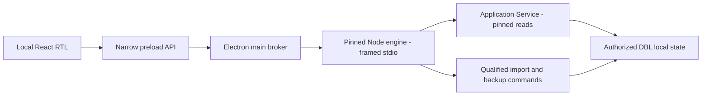

# القرار المعماري المقترح

[الفهرس](README.md) · [القبول والمخاطر](04_DELIVERY_PLAN_AND_GATES.md) · [المراجع](05_EVIDENCE_AND_VERIFICATION.md)

## المقارنة والترجيح

نرشح **Electron + React + TypeScript ومحرك Node خارجي مستقل الإصدار**. المحرك الحالي TypeScript/Node ويحمل better-sqlite3؛ هذا يقلل تغيير لغة التكامل ويحفظ المحرك. كلفة Chromium ومحرك إضافي متوقعة، ولم نقس مقارنة أداء أو ذاكرة بين الأطر.

| الخيار | تكامل المحرك | دون إنترنت والتوزيع | الكلفة والصيانة | الحكم |
| --- | --- | --- | --- | --- |
| Electron + React/TS | وسيط TS ومحرك Node مستقل؛ لا تحميل binding الحالي في Electron | Chromium وأصول محلية؛ حزمة أكبر غالبًا | صيانة إطار العرض وNode؛ ضبط main/preload/renderer | المفضل لتجربة التكامل |
| Tauri 2 + React/TS | وسيط Rust وNode sidecar | WebView2 مطلوب؛ خطة offline أو fixed runtime | TS+Rust وتأهيل WebView2 مع Node؛ الحجم الكلي يقاس | البديل إذا أخفق Electron في ميزانية متفق عليها |
| WPF/.NET | وسيط C#/XAML مع Node؛ لا إعادة كتابة المحرك | .NET self-contained أو runtime مؤهل، مع Node | RTL عبر FlowDirection؛ مهارات وسلسلة اختبار إضافية | صالح لفريق Windows أصلي؛ ليس الخيار الأول للفريق الحالي |
| WinUI 3 | غلاف C#/C++ حول Node | Windows App SDK ونمط نشر محدد | Fluent أصيل لكن متطلبات نشر ومهارات إضافية | يؤجل؛ لا ادعاء أنه غير مناسب |
| متصفح محلي/PWA | خدمة محلية للمحرك وقدرات ملفات مقيدة | runtime متصفح وخدمة أو قيود ملفات | منفذ وتشغيل إضافيان لا يحتاجهما أول تسليم | لا نفضله لتجربة Windows المطلوبة |

اختلاف ABI بين Electron وNode سبب موثق لعدم تحميل binding الموجود عميانيًا في Electron. نختار Node مستقلًا لتثبيت توافق المكتبة وفصل العمل عن العرض. utilityProcess لا يثبت أنه runtime Node المؤهل نفسه. حجم Tauri أو أمان WPF ليسا أفضل تلقائيًا؛ القرار تجريبي ومشروط بالقياس.

## حدود العمليات

لا ERP في هذا المسار؛ الاستخراج مشروع مستقل. الواجهة تمرر اختيارات ومعرفات مقيدة، لا SQL أو ملفات عامة أو أوامر Shell أو نتيجة «verified» تمنح نفسها بها سلطة النشر.

- Renderer: أصول محلية فقط؛ nodeIntegration=false وcontextIsolation=true وsandbox=true، وسياسة محتوى ضيقة. أسماء الأصناف نصوص غير موثوقة، بلا innerHTML أو تنقل إلى روابطها.
- Preload: عمليات مسماة؛ لا كشف ipcRenderer أو require أو execute/readFile عامة. main يتحقق من sender/origin ومن نوع وحدود الطلب، لا يثق بأن TypeScript يضمن المدخلات.
- Broker: حوارات ملفات أصلية وtokens مرتبطة بالنافذة والجلسة والعملية، بدل مسارات حرة من renderer. قائمة أفعال محدودة وصف كتابة لكل مساحة، ولا اتصالات ERP.
- Engine: مسار Node مطلق ومضمن ومثبت، entrypoint ثابت وshell:false؛ لا PATH أو script يختاره الملف. بروتوكول stdio محدود الحجم مع handshake للإصدارات، دون HTTP محلي أو inspector.
- البيانات: القراءة الطبيعية تمر عبر Application Service. أوامر الاستيراد والنسخ والاستعادة إدارة داخل engine تستخدم مساراتها القائمة. لا SQLite handles أو owner/admission ports إلى Desktop.

الفصل بين العمليات لا يجعل محرك Node معزولًا بأذونات Windows؛ قد يعمل برمز المستخدم نفسه. خصوصية المجلدات وسياسة الأوامر واختبارات العبث تبقى بوابات مستقلة، وإخفاء زر لا يطبق RBAC.

## العقود المقترحة وما يحتاج هندسة

نقترح Facade للـDesktop فوق الخدمات الحالية، بعمليات محدودة وDTO مرقم. لا API أو بروتوكول نُفذ هنا. فتح آخر scope والبحث والاستبصارات موجود في main؛ اختيار لقطة V1 قديمة ومقارنتها عبر الحد المعتمد يحتاج توسعة additive يوافق عليها المالك. Catalog S4 لديه واجهة تاريخ منفصلة في Draft؛ لا نلبسها عائلة V1 أو ندعي دمجها.

لا تُرسل دوال JS عبر IPC. يحتفظ engine بمراجع مؤقتة للـscope/cursor/job ترتبط بمساحة ومصدر ولقطة وجلسة، مع حدود ومهلة وغلق. لا تبديل صامت إلى head جديد أثناء الصفحات. تتغير capabilities من المحرك، وليس من شاشة إعدادات.

أفعال مرشحة: readiness، workspace.open، scope.openLatest، products.page، insights.list، file.select/validate، import.start/status، report.create، backup.create/verify، restore.newWorkspace. تاريخ V1 وCatalog اختياريان إلى أن تعتمد عقودهما واعتماديات الفروع. لا generic invoke أو SQL حر.

## الحفظ والإلغاء والتعافي

التحقق يسبق الحفظ، والتأكيد يسبق الأثر. لا نسبة progress إلا من مرحلة يدعمها المحرك. تظهر applied/replayed/committed-needs-attention/failed/unknown كما هي دلاليًا، مع لغة عربية مفهومة. التقرير أو العرض ليسا جزءًا من معاملة قبول Catalog.

الإلغاء قبل الكتابة أو عند نقطة يدعمها المحرك فعلًا. لا قتل عامل أثناء commit لمجرد غلق حوار، ولا «تراجع» يوهم بإلغاء حفظ مكتمل. انقطاع الاتصال يحتاج فحص الحالة وإعادة قراءة قبل إعادة المحاولة. غلق التطبيق مع عمل نشط له سياسة واختبار لاحقان.

أخطاء الواجهة رموز ورسائل وأثر وخطوة تالية؛ لا stack أو مسارات شخصية أو مفاتيح. يلزم تنقيح أخطاء V1 في Facade لأنها ليست جميعًا عقد أمان Desktop. سجل محلي قابل للتدقيق لا يُسمى غير قابل للتلاعب لمجرد تخزينه في SQLite.

HTML يعرض في viewer معزول بلا bridge أو شبكة، أو يحفظ ويفتح بفعل صريح بعد تحقق المسار. لا openExternal إلى عنوان من ERP، ولا تنفيذ ماكرو أو شيفرة واردة.

## التشغيل والتوزيع

الأول مرشح خاص مستقل DBL.exe ضمن ZIP متحقق؛ installer ليس شرطًا. يتضمن إطار العرض والمحرك وDLL والأصول وnotices/SBOM وmanifest، بإصدارات UI/engine/protocol/state family واضحة. لا اعتماد على system Node أو Python أو Git عند المشغل. لا CDN أو telemetry أو crash upload أو auto-update افتراضي.

البيانات خارج install وPreview1، مثل %LOCALAPPDATA%/DBL/Workspaces. اقتراح المجلد ليس تأهيل ACL؛ نفحص الأذونات الفعالة ونتوقف دون إصلاح تلقائي. التقرير والنسخة قد يحتويان بيانات حساسة. backup الحالي غير المشفر ليس تعافيًا مشفرًا خارج المضيف.

اختيار runtime يحتاج مراجعة أمن وABI وتجربة. Node 22 مدرج LTS، لكن ذلك لا يؤهل patch Preview1 المحفوظ. Node 24 ليس بديلًا مباشرًا مع engines>=20<23. لا ترقية أو تثبيت أو اعتماد إصدار مكتبة في هذه المهمة.

نقترح Windows 11 x64 مدعومًا ومرخصًا وحساب Standard للتأهيل الأول، دون أدوات تطوير. Windows 10 الحالي مرجع توافق legacy، لا تأهيل أمان أو ESU مفترضًا. لا تعديل لنظام ERP لتأهيل DBL.
