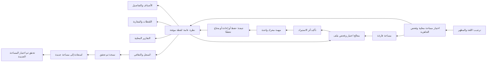

# Screen Map & User Flows

تصميم معلوماتي مقترح 2026-10-25؛ لا mockup مرئي أو تطبيق منفذ. [المتطلبات](02_UX_REQUIREMENTS.md) · [القدرات](08_CAPABILITY_MATRIX.md).

## هيكل التنقل

شريط جانبي يمينًا بالعربية؛ رأس مساحة العمل واللقطة دائم. العناصر: «نظرة عامة»، «الأصناف»، «المقارنات»، «التقارير»، «السجل والتعافي». زر «استيراد ملف» هو الإجراء الرئيسي. الإعدادات والمساعدة/الإصدار في نهاية الشريط. عند ضيق العرض يصير الشريط قابلًا للطي بأسماء متاحة للوحة المفاتيح؛ لا تفقد حالة اللقطة/المصدر.

## الشاشات ومسؤوليتها

| ID | الشاشة والمحتوى/الأفعال | Existing / تطوير / مؤجل |
| --- | --- | --- |
| S00 | ترحيب مختصر، العربية، Light/Dark، شرح الملف المحلي والحدود | واجهة/تفضيلات جديدة؛ لا اتصال أو اكتشاف ERP |
| S01 | اختيار/فتح مساحة؛ إصدار state والخصوصية والموقع المحلي؛ تفريق workspace جديد عن أصل قائم | شروط المسار في المحرك موجودة؛ ACL preflight و workspace registry جديدان؛ لا إنشاء/تصحيح أذونات تلقائي |
| S10 | عدد أصناف/قيمة/وقت المصدر/التغطية، شريط تحذير، آخر نتيجة و CTA | بيانات status موجودة للعينة؛ بطاقات/رسوم/تنسيق جديدة؛ لا إيرادات أو تقديرات فقد |
| S20 | اختيار ملف مؤهل، بصمة متوقعة مستقلة، بصمة محسوبة، نطاق وحالة فحص | check موجود؛ حوار ملفات/عقد UI وتفسير رفض جديد؛ لا ملفات ERP عامة/CSV/SQL |
| S21 | معاينة المنتجات والقيمة/الوقت والقيود؛ تأكيد الاستيراد ونتيجة applied/replayed | check/import موجودان؛ preview+job lifecycle جديد؛ لا اعتماد معاينة كحفظ |
| S30 | جدول أصناف ببحث/تصفية وفرز؛ عدد النتائج ونطاقها؛ اختيار صف | منتجات محفوظة و core filters/pagination موجودة؛ ربط/فرز وتجربة جديدة؛ لا ضمان 5,000 |
| S31 | تفاصيل صنف: الرصيد والتكلفة والقيمة ومصدرهما والتغير بين لقطتين | الحقول موجودة في status؛ تفصيل/مقارنة مقترحان؛ الحركة التفصيلية من qualification تحتاج DTO منفصلًا لاحقًا |
| S40 | اختيار لقطتين، عدد المتغير/الثابت، جدول قبل/بعد/فرق وقيمة ورسم نقاط | history موجود؛ diff/الرسم جديدان؛ لا سبب آلي أو توقع |
| S50 | توليد HTML محلي ونتيجته وبصمته وتحذير مشاركة | report الحالي موجود؛ حوار وجهة/عرض نتيجة جديد؛ PDF/Excel/البريد مؤجل |
| S60 | سجل مهام مختصر، نتيجة وتاريخ/بصمة؛ محاولات غير محسومة وتحذير | status يعيد أعداد تدقيق و unfinished؛ قائمة بشرية كاملة وتفاصيل آمنة جديدة |
| S61 | إنشاء نسخة حالة DBL، حفظ بصمة مرجعية، تحقق، استعادة إلى وجهة جديدة | أوامر backup/verify-backup/restore موجودة؛ معالج/تأكيدات/إظهار النتائج جديدة؛ تشفير/off-host منفصلان |
| S70 | اللغة/المظهر ومساحة العمل والإصدار/القدرات/الخصوصية | UI/preferences/diagnostics جديدة؛ doctor مقيد قابل للربط؛ لا محرر SQL/طرفية/إصلاح النظام |

## التدفقات بالتفصيل

**F01 — أول تشغيل:** S00 → S01 → فحص المسار لا يكتب ERP ولا يصحح ACL → جاهزية اصطناعية أو توقف خصوصية → S10 فارغة. توضح الواجهة أن إنشاء حالة DBL محليًا كتابة مسموحة لاحقًا ضمن المجلد المختار، وأن قراءة ERP فقط ليست وعدًا بأن التطبيق لا يكتب أي ملف.

**F02 — فحص ثم استيراد:** اختيار ملف واحد → اختيار/إدخال بصمة من مرجع مستقل → check → عرض الملف والنطاق والوقت والأصناف والقيمة. فشل الفحص يبقى هنا مع سبب وخطوة آمنة. نجاحه يتيح «حفظ في DBL» بعد تأكيد؛ broker يعيد التحقق من البصمة والسياق لأن الملف ربما تغير. أثناء المهمة يمنع النقر المكرر وتبديل المساحة. applied يفتح اللقطة الجديدة؛ replayed يشرح عدم إنشاء لقطة؛ needs-attention يفتح فحص الحالة لا زر استيراد آلي آخر. ملف أقدم غير معروف يتوقف دون خيار تجاوز.

**F03 — استبصار:** S10 على snapshotA → «قارن» → اختيار snapshotB من نفس المصدر/النطاق → S40 يوضح جهتي المقارنة والفرق والوقت. اختيار T01 يفتح S31 محصورًا في هاتين اللقطتين. النقر على «كيف حُسب؟» يعرض كمية وتكلفة وقاعدة ومصدر، لا سردًا مولدًا غير مسند. الفرز/الفلتر لا يغير معنى الإجمالي العام دون عنوان «نتائج التصفية» واضح.

**F04 — تقرير:** S50 → تحديد وجهة HTML جديدة → تحذير بيانات وأرصدة → تشغيل report → نتيجة وبصمة ومسار مختصر. لا يُفتح HTML غير موثوق في نافذة privileged؛ إما مخرج مولّد معروف يفتحه المالك بتفاعل صريح في متصفح النظام، أو نافذة عرض معزولة بلا preload تُؤهل لاحقًا. لا فتح تلقائي لملف/URL من بيانات الصنف.

**F05 — نسخة واستعادة:** S61 → لا عمليات متزامنة/حالة هادئة → backup → بصمة manifest تُحفظ بوسيلة مستقلة يختارها المالك → verify-backup → اختيار وجهة جديدة خارج الحالية/النسخة → تأكيد «نسخة جديدة من حالة DBL، لا ERP» → restore → status جديد ومقارنة النتائج → سؤال صريح لاختيار المساحة المستعادة. لا تبديل تلقائي للمساحة أو حذف الأصل؛ فشل يبقي مخرجاته ولا يعيد المحاولة خفية.

**F06 — إعادة فتح بعد فشل:** بدء الواجهة → تحقق الحزمة/الإصدار → قراءة جاهزية المساحة ثم status. تحفظ آخر لقطة مقروءة كسياق قديم فقط ولا تعرضها «متحققة» إذا رفض المحرك الحالة. فشل/timeout عقب write محتمل يظل «غير محسوم» إلى فحص؛ لا kill ثم إعلان rollback. إذا لم تسمح الحالة بالقراءة تعرض الواجهة الرمز والتعليمات المحافظة فقط.

## تأكيدات ذات معنى

اختيار ملف/لغة/مظهر/فلتر لا يحتاج سلسلة تأكيدات. استيراد، إنشاء تقرير خاص، نسخة، واستعادة جديدة لها مراجعة أثر واحدة واضحة. لا نطلب تأكيدًا عند كل نقر، ولا نحول موافقة UI إلى تعديل صلاحيات أو تثبيت اعتماديات. أي حاجة لتغيير نظام/حماية تأتي كعائق خارج وظيفة التطبيق، لا زر «إصلاح تلقائي».
