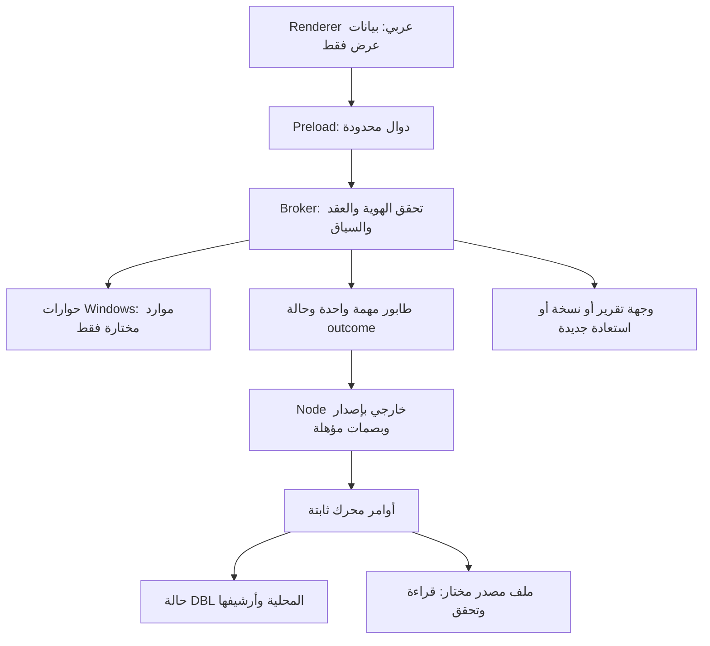

# Engine Integration & Security Boundaries

2026-10-25 · **عقد مقترح غير منفذ أو مؤهل أمنيًا** · [المعمارية](01_ARCHITECTURE_PROPOSAL.md).

## الأساس المقروء

المشغّل الحالي يوفر check/import/status/report/backup/verify-backup/restore بوسائط ثابتة، ومخرجات JSON و exit0/1/2. status يقبل عينة الخمسة ويفحص الأرشيف والتاريخ والتدقيق، لكنه يعطي أعداد أحداث ولا يقدم قائمة GUI كاملة للعمليات. Application Service يثبت القراءة على latest snapshot، و QueryPlan يدعم فلاتر وصفحات محدودة؛ لا sort عام أو API Desktop جاهز. العقود التالية تطوير جديد، وليست مجرد أسماء لواجهات حالية.

قراءة ERP فقط تعني عدم الكتابة إلى المصدر. DBL يكتب حالته وأرشيف الملف والسجل والتقرير والنسخة محليًا ضمن الوجهات المصرح بها. بعض فحوص الحالة تفتح معاملة قفل قصيرة على control.sqlite ثم تتراجع عنها. لا ندعي أن فحص الحالة بلا أي فتح كتابة أو أن التطبيق لا يكتب ملفات.

## العمليات وحدود الثقة

- **Renderer:** sandbox=true، contextIsolation=true، nodeIntegration=false. لا وصول إلى require أو filesystem أو SQLite أو child_process. لا ipcRenderer خام أو دالة إرسال عامة يختار المستخدم قناتها.
- **Preload:** facade بدوال مسماة ومدخلات/مخرجات محددة. لا تحويل رسالة مصدر ERP إلى اسم دالة أو حدث ذي صلاحية.
- **Broker:** يتحقق من window/frame/origin المرسل، وصيغة الطلب وحجمه وحقوله ومراجع workspace/snapshot. يرفض المفاتيح غير المعروفة. لا eval أو shell أو SQL أو open(path) عام أو قراءة متغيرات النظام لصالح الواجهة.
- **Engine worker:** محرك Node مستقل يعمل بهوية المستخدم. عزل العملية ليس Windows sandbox يمنعه من ملفات ذلك المستخدم؛ حصر binary والأوامر والاعتماديات والملفات داخل المنتج يحتاج مراجعة واختبارات.

لا خادم localhost أو HTTP/WebSocket أو قناة SQL. لا اختيار executable أو script من renderer. لا UAC أو خدمة أو تغيير أدوار. لا ندعي منع اتصالات Windows كلها؛ المطلوب لاحقًا إثبات عدم صدور اتصالات التطبيق غير المصرح بها في workflow المؤهل.

## ربط المحرك دون كسر الأساس

الوسيط يستدعي binary Node موثوقًا بمسار مطلق و script ثابت و argv مبني من قائمة أوامر، مع shell=false و windowsHide، وبيئة Node مخفضة. لا يعتمد على PATH أو process.execPath الخاص بـ Electron. يفحص البايتات/manifest قبل تشغيل المحرك، ثم يحافظ على تحقق launcher والقيود الموجودة؛ لا يستبدلها باختبار اسمي فقط.

Electron يستخدم ABI مختلفًا للـ native modules. لا نحمّل better-sqlite3 المؤهلة لـ Node22 مباشرة داخل main/utilityProcess. الاقتراح الأول يحتفظ بعملية Node منفصلة؛ إعادة بناء binding لـ Electron أو utilityProcess مع تأهيل جديد بديل لاحق يحتاج قياسًا وموافقة. أي مرشح Desktop له إصدار وبناء مستقلان؛ لا تعديل Preview1 أو بصماته.

## عقد قدرات مقترح

| Method مفاهيمي | مدخلات الواجهة | العمل المصرح |
| --- | --- | --- |
| chooseWorkspace / openWorkspace | قصد إنشاء أو فتح فقط | حوار نظام ثم فحص مسار/إصدار/خصوصية وإصدار token للسياق |
| chooseSource | workspaceToken | اختيار ملف JSON واحد محليًا، دون استعراض عام للأقراص |
| inspectSource | sourceToken, expectedHash | check ثم DTO محدود للوقت والنطاق والمعاينة والقيود؛ لا raw acquisition |
| importCheckedSource | checkToken, workspaceToken | إعادة تحقق البصمة والسياق ثم import مرة واحدة وإيصال محدود |
| readOverview / listProducts | workspaceToken, snapshotId, filters, cursor | مرحلة أولى من status المحدود؛ ربط core والفرز يحتاجان تطويرًا، لا query عامة |
| compareSnapshots | workspaceToken, leftId, rightId | مقارنة decimal لنفس النطاق؛ DTO مشتق جديد وليس سجل حركات ERP |
| listOperations | workspaceToken, pageToken | إسقاط آمن ومحدود لسجل المهام/المحرك؛ ليس ميزة مكتملة في status الحالي |
| createReport / createBackup | workspaceToken, destinationToken | وجهة جديدة محددة الغرض، لا overwrite |
| verifyBackup / restoreBackup | backupToken, independentManifestPin, newWorkspaceToken | تحقق ثم استعادة جديدة، دون ERP أو تبديل تلقائي للحالة النشطة |
| readCapabilities / readHealth | سياق مساحة اختياري | إصدار وعقد/profile وجاهزية محدودة، لا جرد process/env أو ملفات النظام |

Token ليس إذن Windows جديدًا؛ هو معرف جلسة لمورد محدد وغرض ونافذة ومدة صلاحية، يحله الوسيط داخليًا. المحرك يحتاج المسارات الفعلية، لكن الواجهة تتلقى أسماء عرض مختصرة وتفاصيل مختارة بدل جرد filesystem. فحص المسارات يشمل traversal، UNC/device paths، reparse points، تداخل الوجهات، والتباس تطبيع الأسماء والاتجاه. مقاومة تبديل المورد بعد الفحص TOCTOU متطلب اختبار جديد، لا ضمان مستنتج من حوار الملف.

## المهام والنتائج

كل طلب له protocolVersion و requestId وسياق مساحة/لقطة. الاستجابة محكومة بـ status و operationId و commitOutcome وبيانات عرض أو code آمن. لا يعاد stdout/stderr خامًا إلى renderer أو يجري تفسيره كتعليمات. يربط الوسيط مهمة الواجهة بمعرف المحرك إن وجد؛ سجل مهام Desktop الجديد لا يُقدَّم على أنه تدقيق محرك موجود مسبقًا.

status الحالي يعيد فحص المصادر المحفوظة والتاريخ والسلامة؛ ليس استعلام KPI رخيصًا يصلح polling كل ثانية. نستخدمه عند فتح مساحة/بعد مهمة/بطلب صريح، ونخزن DTO مؤقتًا في الذاكرة مربوطًا باللقطة دون ادعاء حداثة جديدة. يلزم قياس زمنه عند حد اللقطات بدل إدخال cache على القرص أو مسار قراءة يتجاوز التحقق. تُحدد حدود stdout/stderr والصفوف والأطوال والزمن في عقد الوسيط، ويؤدي تجاوزها إلى توقف محافظ، لا تخصيص ذاكرة غير محدود أو تسريب سجل خام.

دورة المهمة: queued → checking → awaiting-confirmation → running → applied/replayed/rejected/needs-attention/unknown-outcome. تعرض مراحل دون نسب مئوية ما دام المحرك لا يرسل progress موثوقًا. exit0 وحده ليس قبولًا؛ نتحقق من JSONschema و status واللقطة. exit2 أو committed-needs-attention يستلزم متابعة. exit1/timeout بعد كتابة محتملة لا يعني تراجعًا آمنًا؛ يظل outcome غير محسوم حتى readback.

قبل الكتابة يمكن إلغاء المعاينة. بعد بدء import لا نقتل الطفل لمجرد ضغط Cancel أو إغلاق النافذة، ولا نعلن rollback. تعرض الواجهة أن إنهاء العملية والتحقق جاريان. إذا وقع انقطاع فعليًا، تحفظ سجل عدم معرفة النتيجة وتفحص الحالة عند إعادة الفتح؛ لا إعادة محاولة خفية. طابور واحد للمساحة يمنع النقر المكرر، مع بقاء SQLite admission الموجود مسؤولًا عن التزامن عبر العمليات.

رسائل مقترحة:
- V1_CAPTURE_NOT_NEWER: «هذا استخراج أقدم غير معروف؛ لم تُقبل لقطة جديدة».
- V1_REFRESH_BUSY: «عملية أخرى تستخدم الحالة؛ انتظر ولا تحذف ملفات القفل».
- hash mismatch: «الملف لا يطابق المرجع؛ تحقق من الأصل».
- عدم هدوء الحالة للنسخ: «احتفظ بالملفات؛ الحالة ليست جاهزة للنسخ».
- فشل حفظ محتمل: «قد تكون البيانات حُفظت؛ يلزم التحقق قبل إعادة المحاولة».

لا زر تجاوز أو إصلاح SQLite أو تعليمات بإعادة حركة ERP لمعالجة استيراد.

## الملفات والمحتوى والخصوصية

مساحة العمل المقترحة تفصل state المملوك للمحرك عن UIpreferences/jobs في مجلد شقيق، وعن وجهات التقارير والنسخ. لا نكتب metadata واجهة داخل state ذي قائمة backup المقيدة. لا ننسخ raw إلى browser cache/localStorage، ولا نسجل صفوفًا أو مسارات شخصية في تقارير عامة أو telemetry. لا فهرسة لخزنة الأدلة أو وصول إليها تحت ذريعة تشخيص Desktop.

مجلدات المصدر والحالة والنسخ والتقارير تحتاج Windows ACL فعلية. AppData أو user ownership أو mode0700 أو acknowledgement لا تثبت الخصوصية. جاهزية ACL واجهة جديدة تحتاج تطويرًا وقياسًا، وتتوقف عند الرفض دون إصلاح. synthetic-only قد يُسمح ضمن اختبار مصرح، بينما بيانات العميل محجوبة حتى إغلاق البوابات. لا تشفير at-rest أو off-host جاهز في backup الحالي.

كل قيمة مصدر نص غير موثوق: عرض نصي محدود ومهرب، لا HTML/markdown فعال أو href/مسار أو أمر من اسم الصنف. أصول React محلية مع CSP صارمة ورفض navigation/popups والـ permission requests والمصادر الشبكية و serviceworkers غير اللازمة. لا dangerouslySetInnerHTML أو CDN أو remote fonts أو telemetry/update checks افتراضية.

تقرير HTML الحالي مهرب ومحلي، لكن ذلك لا يبيح فتح أي HTML داخل نافذة privileged. يفتح المستخدم المخرج المولد بتفاعل صريح في متصفح النظام، أو نؤهل لاحقًا نافذة معزولة بلا preload. الفتح العام لأي path/URL غير مسموح.

## التعافي والتوزيع

النسخة تتطلب حالة هادئة وبصمة manifest مستقلة؛ لا نسخ live لملف SQLite منفرد. restore إلى جديد ثم فحص وتبديل صريح، دون تنظيف الأصل. نفحص protocol/engine/state versions قبل الفتح، ولا نخترع migration أو ضمان downgrade. تحديث يدوي مصرح بعد نسخة متحققة؛ لا auto-update في الأساس المقترح.

التوقيع لا يضمن سمعة SmartScreen أو خلو البرنامج، و Defender لا يُعطّل عند رفضه. مرشح Desktop يحتاج مراجعة مكونات وتوزيع و ACL وحماية و Windows مدعوم مستقلة عن جمال UI. [خطة القبول](06_IMPLEMENTATION_ROADMAP.md) تفصل هذه البوابات.
