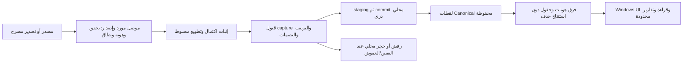

# One-way dynamic ingestion — proposed architecture

2026-10-25 · **PROPOSED; NOT IMPLEMENTED** · [الحقائق](ENGINE_FINDINGS.md) · [الاختبارات](EXISTING_TEST_RESULTS.md).

## القرار المقترح

ابدأ بـ**تصدير كامل موثق لدليل الأصناف، ثم مزامنة يدوية عند الطلب**. نفصل دليل الصنف عن الأرصدة وحركات المخزون. أول هدف هو اكتشاف هوية جديدة وتغيير الاسم/الرمز/الحقول المتاحة مع حفظ التاريخ، لا تعميم ledger والتكلفة والجورنال لكل ERP. لا نحتاج إعادة كتابة المحرك؛ نحتاج عقد مصدر وطبقة قبول وتشغيل عامة بجانب V1 الثابت.

«موصل ديناميكي» يعني عددًا وهويات وصفوفًا متغيرة ضمن **mapping معروف ومؤهل لمورد/منتج/إصدار**. اكتشاف metadata لا يؤهل تفسيرها تلقائيًا. الموصلات تختار بالأهلية والنسخة، ولا تمرر schema أو SQL يكتبه المستخدم أو يقترحه نموذج لغوي.

## النقل يختلف عن توقيت التشغيل

| الخيار | السلامة والصلاحيات | الاكتشاف/الأداء | التعقيد والدعم | التوصية |
| --- | --- | --- | --- | --- |
| ملفات كاملة متجددة | لا وصول DB من DBL؛ ملفات مصرح بها وبصمات وخصوصية | مقارنة كل الصفوف؛ تفوت التغيرات بين تصديرين، وقد يكون الملف ناقصًا | الأسهل في العزل وإعادة التشغيل والدعم؛ يحتاج عقد تصدير كامل | البداية المفضلة |
| قراءة DB مباشرة | حساب يفرض SELECT على عناصر مسموحة، TLS وهوية وموافقة مورد/مالك؛ readOnly=true وحده لا يكفي | قد تقل خطوات المشغّل؛ full scan مكلف أو يحجب ERP بحسب العزل؛ watermark غير مؤهل قد يفقد تغيرات | خاص بكل DB/vendor/version؛ متطلبات شبكة ودعم وتعافٍ منفصلة | لاحقًا بعد تحديد المصدر وتأهيل القراءة؛ لا اتصال الآن |
| يدوي عند الطلب | يختار المشغّل مصدرًا مؤهلًا ويوافق على أثره المحلي | أقل حداثة لكن سهل مراجعة الاكتمال والأخطاء | لا scheduler أو خدمة أو صلاحية نظام إضافية | توقيت أولي مع الملفات، ويمكن استخدامه مع قارئ DB لاحقًا |
| دوري | نفس سلامة النقل، مع هوية تنفيذ واحتفاظ وأسرار إن وجدت | ليس ضمان real-time؛ يحتاج منع تداخل و backoff وحالة توقف عند الشك | يزيد أحمال ولقطات ومحاولات؛ سقوف 32/256 الحالية تحتاج سياسة قبل التشغيل | بعد اكتمال القبول اليدوي والاحتفاظ والتشخيص |
| شبه فوري | فقط API/change-feed/CT/CDC يثبت المصدر دعمه وتهيئته سابقًا وصلاحيات قراءته | أفضل حداثة محتملة؛ gaps/retention/reorder/reconnect/delete تحتاج معالجة | أعلى تعقيدًا؛ تغيير إعداد المصدر لتفعيل tracking ليس قراءة فقط | مؤجل، ولا افتراض دعمه أو تفعيله ضمن هذا التفويض |

لا نفترض قاعدة إبداع سوفت أو API/CDC. SQL Server CT/CDC أمثلة تقنية مشروطة، لا وصف مصدر العميل. التفعيل قد يتطلب تغيير قاعدة وجداول وصلاحيات، وقد ينتهي احتفاظ التغيرات فتحتاج full resync. [Microsoft: tracking](https://learn.microsoft.com/en-us/sql/relational-databases/track-changes/track-data-changes-sql-server)،[enable CT](https://learn.microsoft.com/en-us/sql/relational-databases/track-changes/enable-and-disable-change-tracking-sql-server). لا نفعّلها أو نضيف trigger/rowversion أو نفترض غياب أثر القراءة على الحمل/الأقفال.

## المسار المقترح

كل اتصال محتمل إلى ERP للقراءة وفق عقد محدد فقط. الكتابة إلى حالة DBL و metadata محلية واضحة للمستخدم. لا SQL صادر من الواجهة، ولا صلاحيات source عامة، ولا تغيير إعدادات المصدر لمعالجة فشل sync. حقول اسم الصنف وغيره نص غير موثوق، لا أوامر أو مسارات.

## عقد capture كامل قبل أي تشغيل دوري

يلزم تصميم envelope إصدار جديد، لا تعديل raw V1 أو تمرير حقول غير معروفة عبر Canonical الحالي:

- هوية vendor/product/version و mappingVersion و sourceInstanceId ونطاق الشركة/الكيان/الفرع/المخزن بحسب معنى المصدر، مع sourceEpoch عند استعادة/إعادة تهيئة تغيّر ترتيب المصدر.
- نوع capture=full أو delta صراحة؛ الأول فقط ضمن المرحلة الأولى. scope محدد لا يتغير خفية بسبب filter أو مستخدم/صفحة/شركة نشطة.
- acquisitionId وبصمة bytes و schemaFingerprint ووقت بداية/نهاية ومنطقة/تسلسل موثوق إن توافر. filemtime ليس ترتيب أعمال موثوقًا، و hash من الملف نفسه ليس إثبات أصالة من جهة مستقلة.
- row counts و unique identities وعدد الصفحات و end marker وتغطية الحقول، وأساس اتساق القراءة/التصدير. مقابلة counts مع جهة مستقلة داخل نفس لقطة المصدر حيث يدعمها المورد.
- complete=true لا يصبح صحيحًا لمجرد أن المصدر صرح به أو أن عدد صفوفه يطابق الملف. يجب تأهيل exporter/query/scope، وعدم قطع صفحات أو صفوف بصلاحيات/مهلة/حجم. لا NOLOCK أو جمع صفحات عبر لحظات مختلفة ثم تسميتها لقطة متسقة.
- checksum/length و atomic completed-file handoff بعد انتهاء الكتابة؛ لا استيراد ملف يجري تصديره. تحفظ bytes المؤهلة بلا تعديل وتربط بنتيجة التأهيل.
- اكتمال بنيوي لا يثبت صحة حساب المخزون. دليل الأصناف لا يحتاج افتراض رصيد/تكلفة؛ الكمية والمال optional حتى يتأهل مصدرهما.

ملف مبتور أو scope مختلف أو نهاية صفحات مفقودة لا يغير current. انخفاض عدد الأصناف ليس حذفًا تلقائيًا ولا فشلًا أكيدًا؛ يطلق مراجعة اكتمال وفق سياسة معلنة. full فارغ يحتاج دليلًا صريحًا ورقابة قبول، لا «صفر ملف صالح إذن المخزون صفر».

## هوية الصنف والفرق

هوية الكيان محليًا تربط **source instance + entity kind + stable source key**. connectorId الحالي يميز مسار المصدر في التخزين؛ adapter/version ليسا بديلًا لهوية الشركة أو نسخة القاعدة. لا دمج شركات أو clones أو مخازن تحت namespace واحد بالخطأ. اسم الجهاز/IP أو path الملف ليس هوية business ثابتة بمفرده.

إذا وفر المصدر primary key داخليًا لا يتغير، يصبح Product.id مشتقًا منه ضمن namespace ثابت؛ يبقى SKU حقلًا قابلًا للتغيير. تعديل الاسم أو SKU لا ينشئ صنفًا آخر. إذا كان i_code/الرمز هو المفتاح الوحيد ويتغير، لا نربط بالسابق بالاسم/التشابه تلقائيًا؛ نسجل rekey غير محسوم ونحتاج خريطة موثقة أو مراجعة مصرحًا بها. إعادة استخدام الرمز لعنصر آخر خطر مستقل.

نفرق بين بصمة الملف، وبصمة snapshot الحالية التي تضم header، وبصمة حقول الكيان المتفق عليها. row fingerprint دلالي جديد يحدد new/changed/unchanged؛ لا يستخدم updatedAt وحده أو زمن الملف، ولا يطبع case/أرقام/دقة أو يزيل تشكيلًا دون سياسة mapping. تغيير mapping قد يتطلب إعادة تأهيل baseline، ولا يعرض كتغيير أعمال من ERP.

## الغياب ليس حذفًا

1. capture غير كامل: رفض promotion؛ تظل آخر لقطة مؤهلة current.
2. capture كامل لنفس النطاق ومع هوية سليمة: حفظ المجموعة المرصودة في لقطة جديدة ومقارنة المفاتيح. absent عن اللقطة الجديدة يسمى **not observed in this capture**، لا deleted أو out-of-stock.
3. يبقى تاريخ الصنف والنسخة السابقة؛ يعرض UI آخر رصد مع وسم قديم، دون خلطه بإجمالي اللقطة الحالية أو carry-forward لكمية قديمة كأنها حالية.
4. لا إتلاف صفوف تاريخية. حقل inactive/deleted لا يتأهل إلا بعلم/حدث صريح من مصدر موثق أو قرار منتج مستقل. حتى feed حذف يحتاج معرفة نطاقه ومعنى soft-delete/reversal.

الاختبار الحالي 2→1 يوضح أثر latest: غياب السابق من view دون محوه تاريخيًا؛ هذا ليس registry absence مكتملًا. بناء سجل فرق قابل للتدقيق ومنع سوء تفسيره يحتاج هندسة منفصلة.

## هل نحتاج SQLite أو بروتوكولًا جديدًا؟

**لتخزين عدد مختلف وحقول Product الموجودة عبر snapshots: لا schema rewrite ولا migration جديدة ضرورية.** يمكن إثبات ذلك عبر API والتخزين الحاليين كما أظهرت الاختبارات. إدخال unit/warehouse/entity أخرى أو general stock semantics موضوع منفصل عن عدد المنتجات.

**لـ sync موثوق وقابل لإعادة الفتح: نحتاج عقودًا و metadata دائمة جديدة.** SourceRef و Product و snapshot header الحالية closed-world، ولا تحمل حقول اكتمال/instance/epoch/cursor/absence. لا نحشو المعنى الحرج في اسم SKU أو نص sourceVersion حر، ولا نعطّل رفض المفاتيح غير المعروفة.

التوصية المرحلية: عقد QualifiedCapture وإصدار sync service مستقل بجانب V1، ثم metadata إضافية محكومة الإصدار مثل capture qualification/scope، وربط source identity، وحالة run/promotion، و change index إن دعت الحاجة. يفضّل ربط قرار قبول capture وبصمة دليل اكتماله وتقدم cursor مع commit المنتجات في معاملة SQLite نفسها عبر امتداد writer/coordinator معتمد؛ هذا قد يحتاج migration **إضافية** ونسخة بروتوكول، لا تبديل جدول المنتجات أو إعادة كتابة التخزين.

في إثبات أولي بعد الموافقة يمكن استخدام manifest خارجي immutable للتحقق قبل الاستيراد، لكن ملفًا منفصلًا وسجلًا في DB مختلف لا يحققان ذرية مشتركة تلقائيًا. لا نسمّي هذا إثبات إنتاج قبل تحديد/rehearse crash windows وربط metadata بال checkpoint داخل transaction أو بروتوكول مصالحة مؤهل. لا تغير schema أو protocol الآن؛ تصميم هذا العقد هو أصغر قرار هندسي مطلوب.

## الفشل والتكرار والتعافي

الاستيراد الأول full مؤهل؛ اللاحق full آخر لنفس scope و epoch. snapshotId حتمي من هوية capture/نسخة mapping، ومطابقة هوية/محتوى ترجع replay. نفس الهوية ومحتوى مختلف conflict؛ لا تعديل التاريخ. المصدر القديم المعروف يراجع دون promotion للأحدث؛ القديم غير المعروف أو clock/sequence غير محسوم يتوقف وفق سياسة عامة جديدة، لا يعتمد على ترتيب store وحده.

staging غير مرئي ثم commit ذري، وتحديث حالة promotion/watermark بعد ضمان نفس المعاملة أو مصالحة محددة. عند timeout بعد commit محتمل نقرأ checkpoint، ولا نكرر حركة ERP أو نُنشئ hash/ID جديدًا لتجاوز الرفض. retries محدودة للقراءة العابرة فقط؛ أخطاء الهوية والاكتمال لا يعاد قبولها تلقائيًا. gap في change feed أو تغيير epoch يؤدي rebaseline كاملًا مع موافقة، لا استخدام آخر timestamp أعمى.

سجل تدقيق يربط capture وبصمته/نطاقه و mapping ونتيجة الفرق والرفض وال commit؛ لا ينشر raw خاص أو أسرار. نسخة حالة كاملة هادئة والتحقق/استعادة إلى جديد تبقى مطلوبة قبل تغييرات واسعة. سياسة الاحتفاظ والسعة والأرشفة المصادق عليها شرط للجدولة، دون تنظيف تلقائي لحل السقوف الحالية.
