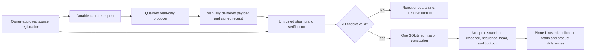

# Stage C Admission & Trusted Source Architecture Proposal

2026-10-25 · **تصميم مقترح فقط — التنفيذ غير معتمد ولم يبدأ.**

اعتمد المالك نتائج Stage B ضمن الاختبارات الاصطناعية، وفوّض إعداد هذا المقترح فقط. هذا لا يعتمد موصل ERP أو مزامنة تشغيلية أو migration أو تغيير المحرك والبروتوكول أو دمجًا. ما زال [PR22 للمنتج](https://github.com/elias-mujally/dbl-legacy-intelligence/pull/22) و[PR15 للذاكرة](https://github.com/elias-mujally/dbl-products-memory/pull/15) مفتوحين كـDraft؛ الاعتماد في المحادثة ليس دمجًا في GitHub.

## التوصية المفضلة

**تسجيل محلي موثوق للمصدر + بيان استخراج موقّع من مُصدر مؤهّل + معاملة قبول واحدة داخل SQLite.** نبدأ بملفات يدوية ودليل أصناف كامل، داخل حالة catalog جديدة مستقلة، ونستفيد من نموذج الأصناف واللقطات الحالية.

يسجّل المالك هوية الشركة والمصدر والنطاق والمفتاح الثابت وإصدار الموصل وطريقة الاستخراج والمفتاح العام بعد تحقق مستقل. لا يستطيع ملف وارد اختيار شركته أو namespace أو مفتاح الثقة. يصدر DBL طلب استخراج مرتبطًا بالمصدر والحالة السابقة؛ ويعيد المُصدر المؤهّل payload وبيانًا موقّعًا يربط البيانات بمشاهدة مصدر متسقة وكاملة.

بعد جميع الفحوص فقط، تحفظ معاملة واحدة اللقطة ودليل قبولها والتسلسل ومؤشر current وحدث التدقيق المحلي. يجب أن تكون هذه الحقائق في قاعدة SQLite نفسها؛ إخراج التقرير أو إيصال خارجي ليس جزءًا من ذريتها.

**حد الإثبات:** التوقيع يثبت هوية المُصدر، لا صدق ادعائه عن مصدر لم نره. لا يمكن إثبات اكتمال ملف عشوائي أو شركته من count/hash أو توقيع وحده. نحتاج تأهيل المُصدر وطريقة المشاهدة وهوية المصدر خارج الملف؛ إن تعذر ذلك يُرفض المسار الموثوق. لا يحق لموافقة بشرية تجاوز نقص هذا الدليل. سلامة التسجيل المحلي والمُصدر المؤهّل افتراضان معلنان، وليسا نتيجة اختبار ERP فعلي.

## الفهرس

1. [المحرك الحالي وأدلة Stage B وحدود الثقة](EVIDENCE_AND_BOUNDARIES.md).
2. [تسجيل المصدر وإثبات الاكتمال](TRUSTED_SOURCE_AND_COMPLETENESS.md).
3. [حالة القبول والذرية وmigration والقراءة التاريخية](ADMISSION_STATE_AND_READS.md).
4. [خطة القبول العدائية وأصغر شريحة تنفيذ مستقبلية](ACCEPTANCE_AND_IMPLEMENTATION_PLAN.md).
5. [بصمات الوثائق ومراجع المصدر](PROPOSAL_MANIFEST.json).

## الفصل بين الموجود والمثبت والمقترح

| الطبقة | الحالة |
| --- | --- |
| المحرك الحالي | أصناف متغيرة؛ مفاتيح يقدمها المستدعي؛ لقطات مستقلة؛ staging/fingerprint/commit؛ عزل namespaces؛ current وpinned reader وقائمة checkpoints |
| المثبت في Stage B | 35 نجاحًا: 12 حالة APIs فعلية و23 مثالًا مرجعيًا. انحدار محدد: 153 نجاحًا تشملها و38 حالة متجاوزة وصفر إخفاقات. نتائج سابقة موثقة، لم نعد تشغيلها في مهمة التصميم |
| الفجوات المثبتة | الاستيراد العام يقبل subset/empty صالحين شكليًا وnamespace منسوبًا خطأً؛ لا بوابة full-source دائمة أو head موثوق أو API تاريخية برقم اللقطة |
| Stage C المقترحة | تسجيل موثوق، دليل مصدر كامل ومصادق عليه، منع الالتفاف عند التخزين، ترتيب دائم، نشر ذري، تدقيق قابل للتعافي وواجهات history/diff |
| ما يحتاج مصدرًا حقيقيًا | استقرار المفتاح، هوية الشركة الفعلية، اتساق التصدير وتغطيته، صلاحيات قراءة المصدر وتأهيل المورد/الإصدار والمُصدر |

## البدائل المستبعدة من الشريحة الأولى

| البديل | سبب عدم اختياره |
| --- | --- |
| هوية الملف وcount/hash ذاتيان، أو مربع «كامل» | لا يكتشفان subset متسقًا ولا يثبتان الشركة |
| توقيع دون تأهيل المشاهدة | يصادق على ادعاء المُصدر، لا على اكتمال المصدر أو صدق نسبته |
| metadata في JSON أو control/audit DB منفصلة | يفتح نافذة تعطل تفصل اللقطة عن دليلها وتسلسلها؛ WAL لا يضمن ذرية مجموعة قواعد منفصلة |
| الاستيراد أولًا ثم trusted لاحقًا | قد تظهر بيانات مرفوضة أثناء النافذة بين العمليتين |
| current حسب أحدث توقيت | لا يعالج الملفات القديمة غير المعروفة أو الزمن المتلاعب به؛ نحتاج head وتسلسلًا معتمدين |
| حقول عشوائية داخل SourceRef أو JSON مخفي في sourceVersion | يغيّر عقدًا مغلقًا ويخفي الثقة؛ الأفضل envelope مستقلة ذات إصدار واضح |
| SQLite كاملة لكل capture ومؤشر ملفات بدل migration | بديل ممكن لكنه يزيد نسخ الحالة وتعقيد pointer/retention والتعافي متعدد الملفات؛ أكبر من توسعة التخزين المثبت |
| SQL مباشر أو CDC أو scheduler الآن | لا يحل هوية المصدر واكتماله، ويحتاج تأهيلًا مستقلًا وصلاحيات وتشغيلًا |

**قرار المخطط:** أوصي بتوسعة schema ذات إصدار واختيار صريح لحالة catalog جديدة، مع metadata داخل قاعدة اللقطات. هذا تغيير تخزين/migration مستقبلي حقيقي يحتاج موافقة، ولا يشمل ترقية V1 أو Preview1. نحافظ أولًا على شكل Product/Canonical، ونضيف envelope وواجهات قبول وقراءة موثوقة مستقلة. لن نستطيع تقديم الذرية المطلوبة بمجرد wrapper حول commit الحالي.

**أصغر شريحة مستقبلية:** مُصدر اصطناعي واحد بشركتين، ملفات يدوية محدودة، بوابة كاملة وhead ذري وreplay/conflict، اختبارات انقطاع وإعادة فتح وتزامن، وقراءات تاريخية وفروق مثبتة. تبقى كل نتائجها موسومة synthetic. لا قارئ ERP أو حركة مخزون أو مؤقت أو ربط GUI في هذه الشريحة.

## نقطة الموافقة التالية

مراجعة افتراضات الثقة، واختيار المعاملة الواحدة وmigration، ومنع مسارات الالتفاف، وعقد القراءة وخطة الاختبارات. يحتاج التنفيذ اللاحق تفويضًا صريحًا للتغييرات في storage/core/application والاختبارات والمفاتيح الاصطناعية والحالة الجديدة. الوصول إلى مصدر حقيقي أو أسراره أو نقل بياناته أو ترقية حالات موجودة أو تغيير الحماية/الشبكة أو النشر تفويضات منفصلة.

هذا PR يغيّر التوثيق فقط. **صفر اختبارات Stage C منفذة**؛ فحص الروابط والبصمات ونطاق النشر تحقق تحريري، وليس نجاحًا للبوابة المقترحة.
